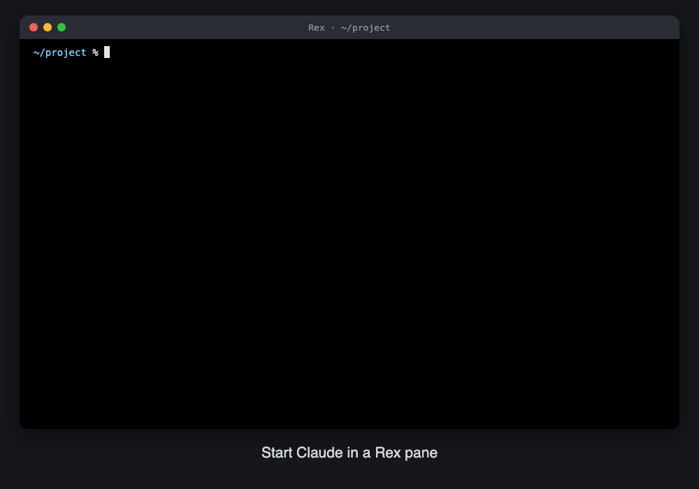

# rex-restore-claude

A Claude Code plugin that brings back the Claude conversation each
[Rex](https://www.superlogical.com/rex) pane was in after the Rex server restarts.



When Claude starts in a pane, a `SessionStart` hook saves `claude --resume <id>` for that
pane. After a restart, the pane's shell comes back with that command on the prompt. Press
Enter to resume. It never runs on its own.

There's also an optional "Restore Claude Session" palette action for a prompt that's already
open.

zsh only for now.

## How it works

Rex already brings back each pane's layout, working directory and scrollback when its
server restarts, and the pane keeps its block ID. It does not bring back the programs that
were running, so a Claude session is gone. rex-restore-claude records how to resume it,
per pane, keyed by `$REX_BLOCK`:

- **Claude Code `SessionStart` hook** (`hooks/hooks.json`): inside a Rex pane, it saves
  `claude --resume <session_id>`. It runs again on `/resume`, `/clear` and compaction,
  so the saved command follows the conversation on screen. After you quit Claude the
  file stays, so the pane keeps offering its last conversation.
- **zsh snippet** (`shell/rex-restore-claude.zsh`): when the pane's shell starts again, the
  saved command is put on the prompt with `print -z`. It is never run: press Enter, edit
  it, or clear it.
- **Rex action** (`rex/restore.lua`, optional): "Restore Claude Session" in the palette
  types the focused pane's saved command onto its prompt, for a pane whose shell was
  already running when the command was saved.

Saved commands live in `${XDG_STATE_HOME:-~/.local/state}/rex-lastcmd/<block-id>`, a
folder only you can read. Files unused for 30 days are pruned. The hook writes only a
command built from `REX_RESTORE_CLAUDE_CMD` and a session ID made of letters, digits and
`-`.

## Install

```sh
claude plugin marketplace add marfillaster/rex-restore-claude
claude plugin install rex-restore-claude@rex-restore-claude
```

Then run `/rex-restore-claude:setup` in Claude Code, or the installer directly:

```sh
bash ~/repos/rex-restore-claude/scripts/install.sh --rex   # --rex adds the Rex action; omit to skip it
```

The installer copies the zsh snippet and the Rex action to
`${XDG_DATA_HOME:-~/.local/share}/rex-restore-claude/`, adds a `source` line to `~/.zshrc`, and
with `--rex` a `dofile` line to Rex's `init.lua`. Re-running refreshes the copies.
`install.sh --uninstall` removes both lines and the copies.

If you start Claude through an alias or wrapper, export it in `~/.zshrc` so the resume
command uses it:

```sh
export REX_RESTORE_CLAUDE_CMD=claude-yolo
```

## Rex action

The zsh snippet puts the saved command on the prompt only when a pane's shell starts. The
"Restore Claude Session" action does the same on demand, for a shell that is already open:
a pane that came back from a restart with an empty prompt, or a prompt you cleared by
mistake.

Install it with `install.sh --rex` (or ask `/rex-restore-claude:setup` for it). That adds
one line to Rex's `init.lua` (`$REX_CONFIG`, or `~/.config/rex/init.lua`) and reloads the
config:

```lua
dofile("/Users/you/.local/share/rex-restore-claude/restore.lua")  -- rex-restore-claude
```

Run it from Rex's command palette as **Restore Claude Session**, or from a shell:

```sh
rex do -b <block> restore_claude_session
```

It types the focused pane's saved command onto the prompt and never presses Enter. It
returns `{"restored": false}` with a reason when the pane has nothing saved, and refuses
a command containing a control character, since a newline, Ctrl-O or an escape sequence
typed into the shell could run it. No key is bound; to add one, put
a line like this in `init.lua` after the `dofile`:

```lua
rex.bind("cmd+shift+r", "restore_claude_session")
```

`rex actions` lists `restore_claude_session` once it is loaded.

## Limits

- zsh only. The Claude hook needs `jq`.
- A pane whose program is Claude itself, with no shell (`rex window new -- claude ...`),
  comes back from a restart as a plain shell with nothing saved. Start Claude from a
  shell in the pane instead, or resume it by hand with the ID from
  `~/.claude/sessions/<pid>.json`.
- The saved Claude command keeps only `--resume <id>`: other flags come from
  `REX_RESTORE_CLAUDE_CMD`.

## Related

[rexurrect](https://github.com/cemcatik/rexurrect) is a fuller save and restore tool for
Rex: snapshots, autosave, Neovim and Codex resume, and its own restore of sessions.
rex-restore-claude relies on Rex's own session restore and only adds the Claude resume
command.
